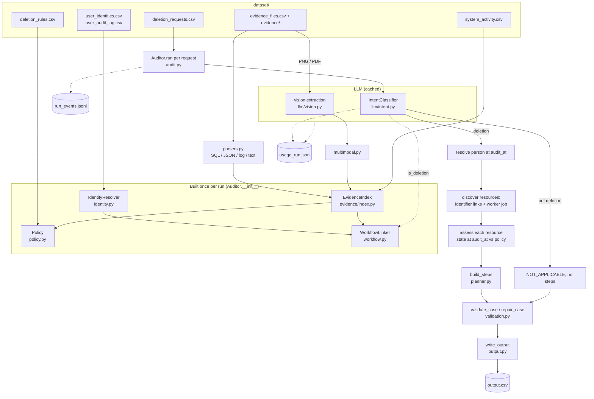

# Architecture

How the deletion-audit agent turns the files in `dataset/` into `output.csv`. Everything here describes the code
under `code/` as it is; module and function names are given so each statement can be checked.

## 1. Data flow

Step by step (`code/main.py` → `Auditor` in `code/agent/audit.py`):

1. **Load** (`loaders.py`). Requests become `Request` records, sorted with `case_sort_key`, so `case_9` comes
   before `case_10`. Identities, audit changes, activity rows, rules and the evidence manifest become frozen
   dataclasses. Enum columns (`reported_status`, `required_action`) are parsed into `ReportedStatus` / `RuleAction`.
2. **Build shared state once** (`Auditor.__init__`): `IdentityResolver`, `EvidenceIndex` (every evidence file
   parsed once), `Policy` (rules plus categories learned from the index) and `WorkflowLinker` (deletion-worker
   activity attributed to requests). The linker sees every request file in `dataset/` whose header is the
   request schema (`discover_request_files`), plus the requests being run, so attribution is the same whether
   you run one case or all of them.
3. **Per request** (`Auditor.run` → `Auditor.audit`):
   1. intent: `IntentClassifier.classify`; anything but `DELETION` → `NOT_APPLICABLE` with no steps;
   2. identity: `IdentityResolver.resolve(email, audit_at)`; no matching user → `COMPLETE` with no steps;
   3. discovery: resources linked to the person (`relevant_resources`), plus resources the worker's job touched
      (`WorkflowLinker.resources_for`) that are a user profile or have observations by `audit_at`;
   4. if no user profile was found, the account-number fallback (section 3.1);
   5. `assess` each resource, in sorted order, into an `Assessment` (or nothing);
   6. `build_steps` → status plus ordered `Step`s.
4. **Validate** every result (`validate_case`), repair if needed (`repair_case`), or replace it with a fallback
   row (section 5).
5. **Write** `output.csv` (`output.write_output`): header `case_id,deletion_status,steps_json`, rows in request
   order, compact JSON with a fixed key order. `usage_run.json` and `run_events.jsonl` are written too.

## 2. Module responsibilities

| Layer | Module | Responsibility |
|---|---|---|
| Config / vocabulary | `config.py` | Every path, dataset file name, model name, retry limit, timeout and attribution time window; `.env` loading |
| | `schema.py` | `StrEnum`s (`DeletionStatus`, `ReportedStatus`, `IntentLabel`, `Phase`, `Operation`, `StepState`, `RuleAction`, `Verdict`); operation→phase/state tables and order; the `Step` dataclass |
| Data loading | `loaders.py` | CSV → typed records; request-file discovery by header; `EvidenceFile.sha256` |
| | `identity.py` | Normalization (`norm_email`, `norm_phone`, `norm_name`, `email_hash`), typed lookup keys (`identifier_keys`), user-id pattern learned from the snapshot, `IdentityResolver` |
| Evidence | `evidence/parsers.py` | SQL dumps (in-memory SQLite), JSON bundles / service exports / ledgers, six log formats, handover text → `Observation`s and complete-listing ("coverage") observations |
| | `evidence/multimodal.py` | Cached screenshot/PDF extractions → `Observation`s; resource resolution through ids, catalog aliases and shared ticket/order references |
| | `llm/vision.py` | Extraction prompt and JSON schema, model extraction, offline PDF text parser, extraction validation |
| | `evidence/model.py` | `Observation` (with `exists`, `exposed_fields`, `user_ref`, `flow_enabled`, `restore_allowed`), canonical field names, learned `SystemMap` |
| | `evidence/index.py` | Parses everything once; catalog links from `LINK_RESOURCE_IDENTITY` activity; resolves systems; indexes by resource and identifier key; `absence_proof`; `visible` / `citable` |
| Reasoning | `llm/intent.py` | Decisions-API intent classification, per-text cache, deterministic fallback (`heuristic`) |
| | `workflow.py` | Attributes deletion-worker activity to requests (jobs, anchors, policy actions) |
| | `policy.py` | Data categories (explicit `record_type`, learned per prefix/system, name match) and the required `RuleAction` |
| | `audit.py` | `Auditor`: per-request orchestration, per-resource assessment, evidence selection, guarded `run` |
| | `planner.py` | `Assessment` → ordered FINDING / REMEDIATION / VERIFICATION steps |
| Validation | `validation.py` | Contract and cross-field checks on the wire form; deterministic repair |
| Output | `output.py` | `serialize` and `write_output` |
| Infrastructure | `llm/client.py` | OpenAI SDK wrapper; validated calls with retries and error feedback (`with_retries`, `decide`, `respond_json`) |
| | `llm/usage.py` | Per-call token accounting, cost, summary, `usage_run.json` |
| | `runlog.py` | `EventKind`, `RunEvent`, logging setup, `run_events.jsonl` |

## 3. Identifiers

**Who the person is at `audit_at`** (`IdentityResolver.person_at`). The resolver starts from the current snapshot.
It rolls back every audit-log change made *after* `audit_at`, taking that change's `old_value` as the value at
audit time. It then adds the `old_value` of every change made *at or before* `audit_at`. The result holds every
name, email, phone and email hash the person had by `audit_at`, and nothing they acquired later.

**Which user a request belongs to** (`IdentityResolver.resolve`). The request email is looked up in an index of
current and historical emails. When several users match, the one who held that email at `audit_at` is preferred;
otherwise the first by `user_id` is taken.

**Typed keys, exact matching.** Every identifier becomes a typed key (`identity.identifier_keys`,
`Person.keys`):

| Key | Built from |
|---|---|
| `email:` | the email, lower-cased |
| `hash:` | SHA-256 of the normalized email, or a stored email hash |
| `phone:` | the phone number, digits only |
| `name:` | the name, accent- and case-folded, whitespace collapsed |
| `user:` | a stable user id, matched against a pattern learned from the snapshot ids |

Raw evidence values are classified by shape (contains `@`, matches the user-id pattern, 64 hex characters,
phone-like, multi-word name). Nothing is matched fuzzily.

**Linking evidence to the person** (`EvidenceIndex.linked_resources`). A resource is linked when an observation
visible at `audit_at` carries one of the person's keys. Keys can come from several places:

* identifier fields, after field names are canonicalized (`canonical_attrs`);
* emails and phones inside free text;
* lookup fields such as `lookup_key`, `match_key` and `subject_ref`;
* for logs, any identifier seen anywhere in the same `trace_id` (`parse_log`);
* `LINK_RESOURCE_IDENTITY` activity that names the resource with an email and user id, if dated by `audit_at`
  ("catalog links"). Such a link also records the displayed alias, e.g. a file name or an `NST-…` export number,
  so screenshots and PDFs that show only the alias resolve to the resource.

`Auditor.relevant_resources` keeps a linked resource only if it has an observation dated between `requested_at`
and `audit_at`, which drops lookups from an older, unrelated request by the same person.

### 3.1 Records that no longer carry identifiers

A deleted account or an anonymized row cannot be linked by identifier. `WorkflowLinker` attributes the deletion
worker's activity to requests instead:

* **Worker.** The worker is the `source_system` that emits the most remediation operations (`deletion_worker`).
* **Jobs.** Requests from the same user with the same `reported_at` form one job.
* **Anchors.** A job's anchor is a worker `DELETE_RECORD` on a user-profile resource within
  [`reported_at − 1.6 h`, `reported_at + 15 min`] (`ANCHOR_BEFORE` / `ANCHOR_AFTER` in `config.py`). Jobs are
  processed in (`reported_at`, `case_id`) order:
  1. first pass: anchors whose resource the evidence already ties to the job's user;
  2. second pass: unowned anchors, preferring a reported result that matches the claim (`COMPLETE`↔`SUCCESS`,
     `PARTIALLY_COMPLETE`↔`PARTIAL`, `NOT_STARTED`↔`FAILED`);
  3. a job with no profile submission is anchored on the closest unowned policy action in the same window.
* **Policy actions.** Other worker actions are logged either before the report ("Policy action completed …",
  between the anchor and `reported_at`) or as results up to 2.5 h after it (`FOLLOW_AFTER`). Each job's style is
  learned from actions the evidence already attributes to its user. An unowned action goes to the first
  compatible job in order, one action per (event type, target system) per job. Actions owned by someone else are
  never taken.

**Account-number fallback** (`Auditor.audit`). If discovery found no user-profile resource, the code adds
`account_<NNN>` built from the digits of `user_<NN>`, provided no other user owns that account. This relies on
the dataset's id convention, not on evidence (see DECISIONS.md, D10).

## 4. State at `audit_at`, sync and restore paths, retention

### Point in time

`index.visible(o, audit_at)`: an observation counts if it was *observed* at or before `audit_at` (its record
time; for screenshots/PDFs, the file's capture time). `index.citable(o, audit_at)`: it may be *cited* only if the
file was also *captured* by `audit_at`. Observations of a resource are ordered by (observed time, capture time,
file id). For each question (exists? flow enabled? restore allowed?) `latest_where` keeps the newest observations
that answer it.

**Complete listings prove absence** (`EvidenceIndex.absence_proof`). A coverage observation means "these are all
the records of system S at time T". There are three sources:

* SQL dumps with a `snapshot_scope` table: one listing per scoped system;
* unscoped SQL dumps whose rows all resolve to a single system;
* JSON snapshot collections that name a `data_store` and contain plain records.

The newest citable listing that omits the resource is the absence proof. An empty SQL listing does not count; an
explicitly empty JSON collection does.

### Category and required action

`Policy.category_of` decides the category, in this order:

1. the newest explicit `record_type` that is a rule category or `DATA_FLOW`;
2. otherwise a default learned from explicit `record_type`s: by resource prefix, then by system, then by word
   overlap between the prefix/system name and the rule category names, else `SECONDARY_IDENTIFIER`;
3. two refinements on top of that default:
   * a `SUPPORT_MESSAGE` seen in an attachment source or a PDF becomes `SUPPORT_ATTACHMENT`;
   * a non-profile record found through a `contact_` lookup becomes `SECONDARY_IDENTIFIER`.

`Policy.action` returns the rule's `required_action`. `DATA_FLOW` returns `DISABLE`, and categories missing from
the rules return `DELETE`. Which system owns a resource comes from `SystemMap`. Prefixes are learned from
evidence that names its system explicitly, and otherwise from the most common activity `target_system`.

### Sync and restore paths

| Category | Decided by | Verdict when active | Steps | When inactive |
|---|---|---|---|---|
| `DATA_FLOW` | `Observation.flow_enabled`: `result=ACTIVE` → enabled, `DISABLED` → disabled, else the `enabled` field | `ACTIVE_FLOW` | `REPORT_ACTIVE_DATA_FLOW` → `DISABLE_DATA_FLOW` → `VERIFY_DATA_FLOW_DISABLED` | verified as `DISABLED` |
| `BACKUP_ARCHIVE` | `Observation.restore_allowed`: `ACTIVE` → allowed, `BLOCKED` → blocked, else `restore_allowed`, else `eligible and not deletion_block` | `RESTORE_RISK` | `REPORT_RESTORE_RISK` → `BLOCK_RESTORE` → `VERIFY_RESTORE_BLOCKED` | verified as `BLOCKED` |

Within each phase, steps follow the operation order in `schema.Operation`. In REMEDIATION,
`DISABLE_DATA_FLOW` and `BLOCK_RESTORE` therefore come before `DELETE_RECORD`, `REDACT_RECORD` and
`ANONYMIZE_RECORD`, so recreation paths are closed before records are changed. Ties are broken by `system_id`,
then `resource_id`. There is no per-record dependency graph; the order comes from the operation table alone
(`planner.build_steps`).

### Records: delete, redact, anonymize, retain

For every other category (`Auditor.assess`), existence comes from `Observation.exists`. It reads the result
words (`NOT_FOUND`/`DELETED` vs `FOUND`/`PRESENT`/…), HTTP status, `rows`, `total_hits` and presence flags; any
snapshot row counts as existing, and so does a log line that returned identifiers. On top of that, if a newer
citable complete listing omits a record that was last seen present, the record is treated as absent (not for
`RETAIN` categories).

| Required action | Absent at `audit_at` | Present at `audit_at` |
|---|---|---|
| `DELETE` | `VERIFY_RECORD_ABSENT` | `REPORT_REMAINING_RECORD` → `DELETE_RECORD` → `VERIFY_RECORD_ABSENT` |
| `REDACT` (support messages, email logs, **account tombstones**) | `VERIFY_RECORD_ABSENT` | exposed: `REPORT_EXPOSED_PII` → `REDACT_RECORD` → `VERIFY_RECORD_REDACTED`; otherwise `VERIFY_RECORD_REDACTED` |
| `ANONYMIZE` (analytics, telemetry) | `VERIFY_RECORD_ABSENT` | exposed: `REPORT_EXPOSED_PII` → `ANONYMIZE_RECORD` → `VERIFY_RECORD_ANONYMIZED`; otherwise `VERIFY_RECORD_ANONYMIZED` |
| `RETAIN` within retention | no step | `VERIFY_RECORD_PRESENT` |
| `RETAIN` past `retention_until` | treated as `DELETE` (the listing override above was not applied) | treated as `DELETE` |

"Exposed" (`Auditor.exposure`) means any of:

* a non-empty name, email, phone or email hash;
* an email or phone in free text;
* `result=IDENTIFIABLE`;
* a PII scanner hit (`detector=direct_identifier` or a non-zero `direct_identifiers`);
* for `ANONYMIZE` categories only, a stable `user_ref`.

`ANONYMIZED` / `REDACTED` results mean nothing is exposed. **Account tombstones** therefore pass when only the
stable `user_id` remains: `user_ref` is not an exposure for `REDACT` categories, while name, email, phone or hash
are. `retention_until` is the newest `retention_until` / `retained_until` / `retain_until` value on the record.

A resource known only from worker activity (no observations by `audit_at`) is assessed only if its category must
be deleted. It is then verified absent, citing the absence proof if there is one.

### Evidence cited

`Auditor.make` cites the newest citable observation that supports the conclusion. For a compliant absent record
without one, it cites the absence proof. In an `INCOMPLETE` case, remediation and verification steps carry an
empty `evidence_id`, and so do compliant verifications (`planner.build_steps`).

## 5. Failure-handling layers

From the outside in:

| Layer | Where | What it does |
|---|---|---|
| 1. Transport retries | `LLMClient.client` | OpenAI SDK `max_retries=3`, `timeout=120` s (`OPENAI_SDK_MAX_RETRIES`, `OPENAI_TIMEOUT_S`) |
| 2. Validated model answers | `LLMClient.with_retries` | Each answer is checked: intent by `check_intent` (allowed label, confidence in [0, 1]); extractions by refusal detection, JSON parsing and `check_extraction` (record kinds, emails, ISO dates/timestamps). A refusal, invalid answer or API exception is retried up to `LLM_MAX_RETRIES = 2` times; validation errors are appended to the next prompt, API errors keep the previous feedback. Then `LLMRejected` |
| 3. Model fallbacks | `IntentClassifier.classify`, `vision.extract_file` | Intent → `heuristic` (not cached, so a later run retries the model). PDF → `extract_pdf_offline`; screenshot → keep the previous cache, or skip the file |
| 4. Cache integrity | `multimodal.load_cached` | A cached extraction is used only if its `source_sha256` matches the file bytes |
| 5. Evidence isolation | `EvidenceIndex.__init__` | A file that fails to parse is skipped and logged |
| 6. Case guard | `Auditor.run`, `Auditor.fallback` | An exception in `audit` → `NOT_APPLICABLE` (not a deletion) or `INCOMPLETE` with no steps |
| 7. Output validation | `validation.validate_case`, `repair_case` | Errors: unknown status; `NOT_APPLICABLE` with steps; `COMPLETE` with findings/remediation; wrong fields, numbering, phase/state or order; unknown or post-`audit_at` evidence; a finding without remediation/verification (and vice versa); evidence on future steps. Warnings: `COMPLETE` step without evidence, `INCOMPLETE` without findings, finding without evidence. Repair derives the status from the steps, empties `NOT_APPLICABLE`, drops malformed steps, blanks forbidden evidence, reorders and renumbers; it never adds records |
| 8. Event log | `runlog.event` | Every retry, failure, fallback, evidence error, case error, repair, invalid case and warning is logged and written to `run_events.jsonl` |

`code/evaluation/validate_output.py` runs the same `validate_case` over a finished `output.csv` and also checks
the file as a whole: header, row count, case-id set and order.
